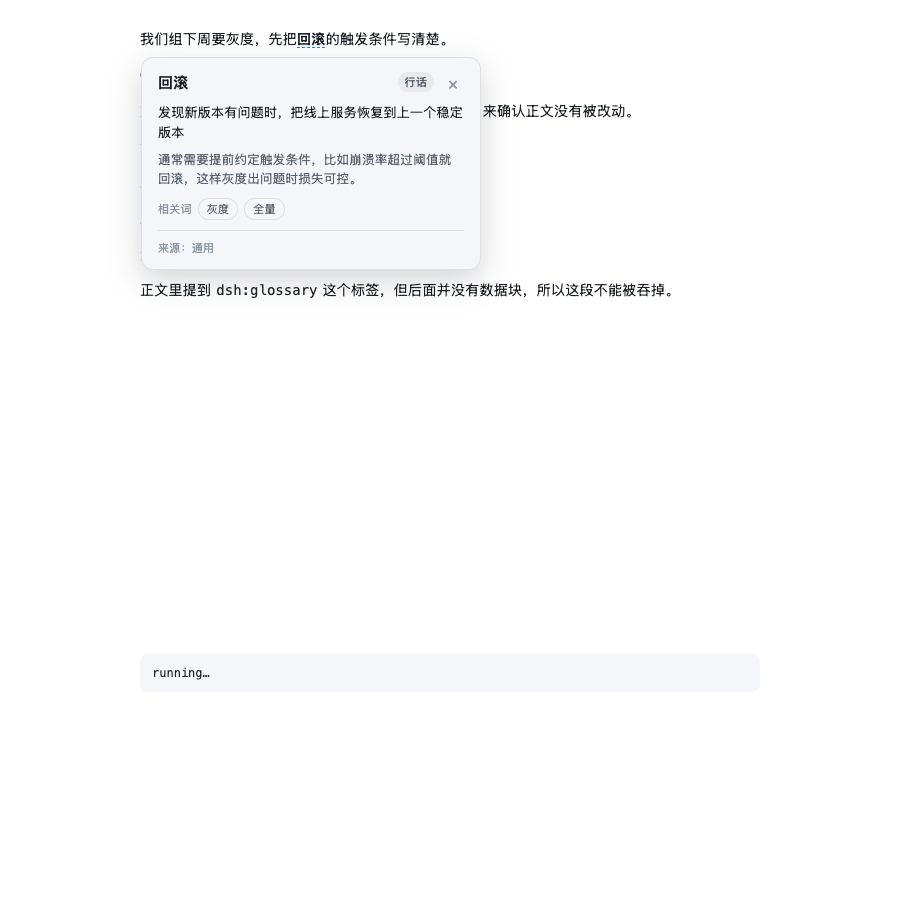
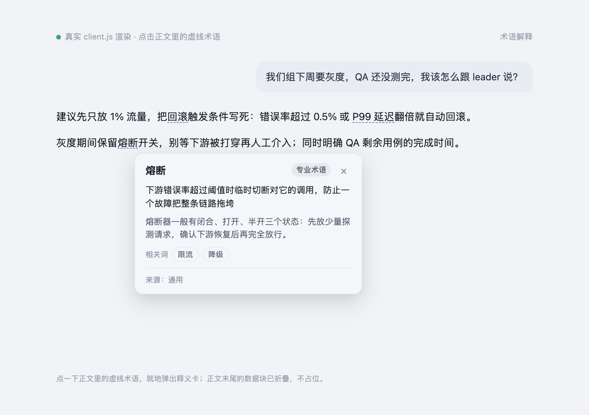

# 术语解释（Glossary）for DeepSeek Harness

> **一句话**：回答照常写，末尾附一个术语数据块；前端把这个块藏起来，并把正文里的专业名词标成可点击的虚线，点一下弹出释义卡——用户不必再发一轮消息，就能看懂单个词。

这是把「术语解释」的产品描述落到 DSH 的一个完整插件：Host 半体往系统提示注入选词与释义规则，Client 半体在已渲染的回答里定位术语、加虚线、开卡片。两个半体各自可单独卸载，不依赖 Intelligent UI 或 Hook Follow-up。



## Showcase

四个真实场景（全部由真实 `client.js` 渲染，数据块真的被隐藏）：


单个场景：[工程 · 发布](showcase/showcase-1.png) · [学术 · 句法](showcase/showcase-2.png) · [职场 · 产品](showcase/showcase-3.png) · [内部名词 · 上下文推断](showcase/showcase-4.png)

真实对话里的浮层（卡片浮在术语下方，遮住正文是正常的弹层行为）：



真实产品页的效果由 DOM 断言验证（桌面端登录态 + headless Chrome，见下）：五条术语的回答里 AST / SLO / 冷启动 / 幂等 / 回归测试 全部是蓝色虚线，数据块被折叠，点「幂等」弹出释义卡；2026-10-23 用户在本机刷新后确认这五个词全部标出。

重新生成：

```sh
CHROME="/Applications/Google Chrome.app/Contents/MacOS/Google Chrome" node showcase/shot.mjs
```

## 与需求稿的两处实现差异

需求稿的设计是完整的；实现时有两件事必须补齐，否则用户看到的会是一段裸露的 JSON。

### 1. 数据块必须由前端「藏起来」，而不是替换渲染器

DSH 的正文走 shipped 的 Markdown 渲染器，插件没有稳定的「消息内容渲染钩子」。读 shipped 实现可以确认：`html` 节点会原样作为**文本**返回（`case "html": return e.value`），所以 `<dsh:glossary>` 这个标签会以纯文本出现在回答里，后面的 JSON 也会作为普通段落渲染出来。

要抹掉它只有两条路：

- 整段替换 `assistant-step` 渲染器。升级即碎，不采用。
- 在已渲染的 DOM 上工作：把数据块对应的文本节点包进 `display:none` 的 span，并把只装着该文本的段落一起折叠。

本插件走第二条，并且**保留需求稿的数据块格式**——它有三个实际好处：一次请求就能产出（不需要先调工具再写正文，每轮不多烧一次上下文）、术语是模型写完正文之后才挑的（更贴合本轮语境）、JSON 结构由 Host 侧的格式规则约束。

### 2. 渲染器会吃掉标签的尖括号，所以按「末尾合法 JSON 数组」识别

在真实产品里跑起来才看清：shipped Markdown 渲染器把开头的 HTML 块变成**去掉尖括号的纯文本**，结尾的 `</dsh:glossary>` 反而被转义成文本。也就是说 DOM 里读到的原文长这样：

```text
……正文……
dsh:glossary
[{"t":"CDP",…}]
</dsh:glossary>
```

第一版按 `<dsh:glossary>` 找块，于是永远找不到真块；反过来，正文里提到这个标签（比如我在回答里讨论它）又被误判成块，把后面的正文吞掉。

现在的识别规则不依赖标签拼写：只认**行尾那个 `]`**，反向配对出外层 `[`（跳过字符串内部），再 `JSON.parse` 并校验条目形状；要求数据块**一直延伸到行尾**（后面只允许空白和可选的 closing tag），并且至少有一条带 `t`/`forms`/`def` 的合法条目才成立。不能从尾部逐个候选回溯：五条术语的块里 `forms` 和 `rel` 加起来有 10 个嵌套数组，逐个回溯很容易在真正的块之前就放弃（0.1.1 就栽在这里）。识别到以后，隐藏区间从标签文本（`dsh:glossary` 或 `<dsh:glossary>` 都认）一直覆盖到数组和 closing tag。这样既不会把「正文里提到标签」当成块，也不会因为渲染器改了标签写法而失效。

### 3. `<dsh:glossary_known>` 改为「本对话已标注过的词不重复标」

需求稿里「前端注入 `<dsh:glossary_known>`」在 DSH 里没有对应通道：Client 半体无法改写系统提示，而 Host 半体看不到前端状态。实现改成一条等价的提示词规则：模型在历史里能看到自己上一轮写过的术语块，不再重复标注。功能上等价，代价只是每个新对话没有预置词表。

## 用户看到的样子

回答正文照常；正文里第一次出现的术语被标成**蓝色虚线**（`text-decoration: underline dashed`），鼠标悬停有浅色底，键盘 Tab 可聚焦、Enter/空格打开。点击后在词附近弹出释义卡：

- 顶部：术语、类型徽章（专业术语 / 缩写 / 行话 / 学术概念 / 内部名词）、关闭按钮；
- 一句话释义（`def`）；
- 展开释义（`more`，模型认为没有可补充内容时省略）；
- 相关词（`rel`，0–3 个）；
- 底部来源标注（`basis`：通用 / 上下文推断）。

数据块不占位、不留空行；正文文字、排版、可复制性都不变（复制按钮复制的是会话原文，仍带数据块，见「已知限制」）。

## 安装

### 直接安装（固定 tag）

```text
plugin_manager(action: "install_bundle", target: "git+https://github.com/an-an-618/dsh-glossary.git#v0.2.1")
```

### 从 Release tarball 安装

```text
plugin_manager(action: "install_bundle", target: "https://github.com/an-an-618/dsh-glossary/releases/download/v0.2.1/an-an-618-dsh-glossary-0.2.1.tgz")
```

### 从本地目录安装（开发）

```sh
git clone https://github.com/an-an-618/dsh-glossary.git
```

```text
plugin_manager(action: "install_bundle", target: "/absolute/path/to/dsh-glossary")
```

装好后刷新一次 Web UI（新 Client 半体在页面下一次加载时生效）。卸载：

```text
plugin_manager(action: "remove_bundle", target: "@an-an-618/dsh-glossary")
```

## 配置

在 **设置 → 插件 → 术语解释** 里改（`cordis.patch.yml` 的同名列是默认值）。所有字段都是 `volatile()`：保存后下一轮生效，不用重启 Host。

| 设置 | 默认 | 说明 |
|---|---|---|
| `enabled` | `true` | 总开关。关闭后系统提示不再注入术语规则，客户端也不再装饰（已装饰的会被还原）。 |
| `max_terms` | `5` | 每轮最多解释的术语数，1–8。候选超出时模型按「一词多义的缩写 > 理解正文必需的概念 > 行话 > 其他」取舍。 |
| `def_max` | `40` | 一句话释义上限（中文字数），20–120。 |
| `more_max` | `150` | 展开释义上限（中文字数），40–400。 |
| `language` | `follow_user` | `follow_user` = 释义跟随用户语言；`zh` / `en` 同时把规则文本固定为中文 / 英文。 |
| `strictness` | `relaxed`（本插件发布默认；原需求稿契约为 `standard`） | 触发尺度：`relaxed` = 宁可多一条，代码场景也照标；`standard` = 原规则；`strict` = 更克制（跳过边缘词、短回答）。 |

## 工作原理

Host（`index.js` + `lib/prompt.js`）：

- 注册系统提示段 `glossary`（order 2450，位于 Intelligent UI 的 2400 与 Hook Follow-up 的 2500 之间），内容是需求稿里的完整契约：前置原则、整块省略条件、选词规则、`def`/`more`/`rel`/`kind`/`basis` 写法、数据块格式与正反例；
- 数值上限从实时 `Config` 读入提示文本，改设置下一轮就生效；
- 与 Hook Follow-up 的先后关系写进提示：术语块落在正文之后、回复最末尾，其他往末尾追加的插件块排在它之后（本 profile 的 Hook 走工具调用，不存在文本冲突）。

Client（`client.js`）：

- 用 `MutationObserver` 盯住聊天区（`[data-chat-flow]`，没有就退回 `document.body`），只处理**已经流式结束**的回答行（`[data-chat-flow-kind="assistant-step"]`，且不含 `[data-streaming]`）；
- 从行文本里解析末尾的数据块：不依赖标签拼写，从后往前找候选数组，做括号匹配（跳过字符串内部）和 `JSON.parse`，只接受延伸到行尾、且至少一条合法术语条目的数组；`forms` 必须真的出现在块之前的正文里，否则该条不标（块仍然隐藏）；
- 隐藏数据块：按字符区间包 `display:none` span，并折叠只含该文本的段落/`div`，所以不会留下空行；
- 标记术语：按阅读顺序，每个术语只标第一次出现的写法（正文里出现多次也只标一处，避免满屏虚线）；
- 点击/键盘由 `document` 上的委托监听处理，卡片渲染在 `shell.overlay`（帧级浮层，不会被滚动容器裁掉），滚动或点空白处自动关闭；
- 所有写入都记录在案：卸载插件、关掉开关或热重载时按原样还原 DOM；
- 重复装饰是幂等的：React 重渲染抹掉标记后，下一轮 observation 会重新补上。

插件设置页注册在 `plugins.row.config`（key 为 `@an-an-618/dsh-glossary#glossary`）。

## 验证

### 安装前自检

```sh
cd "glossary"
node scripts/check.mjs
```

覆盖：`node --check`、Host/Client 两套单测、系统提示模板守卫（出现 `{{` 会让 DSH 每轮报模板错误）、清单与导出、locale、以及「Host 半体不得碰 DOM、运行时代码不得有 eval/fetch」的源码卫生检查。

### 真实浏览器里的装饰与卡片

```sh
CHROME="/Applications/Google Chrome.app/Contents/MacOS/Google Chrome" node test/browser-check.mjs
```

`test/fixture.html` 复刻 shipped Markdown 的 DOM 结构（正文段落 + 裸露的 `<dsh:glossary>` 文本节点 + JSON 段落），用真实的 `client.js` 跑 24 条断言：装饰生效、数据块隐藏、可见文本无 JSON、点击开卡、卡片字段完整、二次装饰不重复、还原后源文本回来；同时产出两张截图（`test/fixture.png`、`test/fixture-card.png`）。

本工作区的验证记录（2026-10-22，profile `desktop`）：

- `scripts/check.mjs` 全绿（语法、14 条 Host 单测、17 条 Client 单测、提示模板守卫、清单/locale/卫生检查）；
- 真实 Chrome + `test/fixture.html` 28/28 条断言通过，截图确认蓝色虚线与释义卡；
- **真实产品页验证**（用桌面端自己的登录 cookie 把真实 Web UI 开在 headless Chrome 里）：五条术语的回答标出 AST / SLO / 冷启动 / 幂等 / 回归测试五个词，块被折叠，回答可见文本里没有 `"t":"`，点击「幂等」后释义卡在 `shell.overlay` 里正常弹出；更早的两条回答（1–3 个术语）同样正常；
- **用户本机确认**（2026-10-23）：刷新后五个词全部标出；
- `install_bundle` 返回 `application: applied`，无 warning；
- Host：`Config` 返回 `include:glossary` 的 schema（五个字段、`volatile`、`packageDir` 已解析）；
- Client：`shell.overlay` 出现 `glossary-card` occupant（order 200，active），`plugins.row.config` 出现 `@an-an-618/dsh-glossary#glossary`；
- 系统提示里出现 `## 术语解释（glossary）` 段，且数值上限与配置一致（默认 5 / 40 / 150）。

## 文件结构

| 文件 | 作用 |
|---|---|
| `index.js` | Host 半体：注册系统提示段 + 实时配置 |
| `lib/prompt.js` | 中英规则文本、数值上限填充、配置归一化 |
| `client.js` | 浏览器半体：数据块解析/隐藏、术语标记、释义卡、设置页 |
| `test/fixture.html` | 真实 DOM 结构夹具 + 24 条浏览器断言 |
| `test/browser-check.mjs` | 无依赖的 CDP 截图与断言驱动 |
| `showcase/index.html` | 四场景画廊（复刻 DOM + 真实装饰 + 真实卡片） |
| `showcase/popover.html` | 对话里的真实浮层场景 |
| `showcase/shot.mjs` | 生成 6 张 showcase 图（无依赖 CDP） |
| `test/host.test.mjs` / `test/client.test.mjs` | 无依赖单测 |
| `scripts/check.mjs` | 安装前自检 |
| `cordis.patch.yml` | Bundle 行与默认配置 |
| `locale/*.json` | 插件管理页的标题与说明 |

## 已知限制

- **复制仍带数据块**：复制按钮取的是会话原文，数据块只在前端视觉上隐藏。介意的话可以接受一个取舍：把术语改成 Host 工具 + `presentationMeta`（像 Hook Follow-up 那样），日志干净但每轮多一次模型请求、术语也必须在正文写之前想好。
- **尺度越松，噪音越多**：`relaxed` 下基础编程词之外的工程行话都会标出来；嫌多就在设置页切回 `standard` 或 `strict`。
- **流式末尾瞬间可见**：数据块在模型输出结尾，装饰器在 180ms 去抖后隐藏，正常情况下人眼看不到，但慢网下可能闪一下。
- **块位于回复末尾时最稳**：严格解析要求数据块延伸到行尾；块后面还有别的文字时，会退回「漏块保护」——只要 marker 与括号对出现在回答后半段，照样折叠（但那种情况下隐含位置要求不如行尾严格）。
- **嵌套数组不能靠候选回溯识别**：0.1.1 的候选回溯上限在 5 条术语时失效，0.1.2 已改为反向配对；新增「五条术语」回归防止再次退化。
- **DOM 结构不是公开契约**：装饰器依赖 `data-chat-flow`、`data-chat-flow-kind="assistant-step"`、`data-chat-turn`、`data-streaming` 与 `_markdown_*` 之外的结构。DSH 升级改了这些属性时，插件会安静降级（不装饰、不报错），不会破坏界面。
- **只标第一次出现**：同一个术语在正文里多次出现只标第一处；这是为了不让回答变成满屏虚线。
- **内部名词依赖上下文**：没有上下文的内部系统名一律不标（需求稿的硬规则），因此某些回答里会出现「本该解释但不解释」的词。
- **行内代码/链接不标**：`pre`、`code`、`a`、公式里的词一律跳过，这是需求稿的规则。
- **提示词成本**：规则段约 2.4k 字符（中英同量级），`enabled: false` 可整块关掉。

---

[](https://github.com/deepseek-ai/deepseek-harness)
